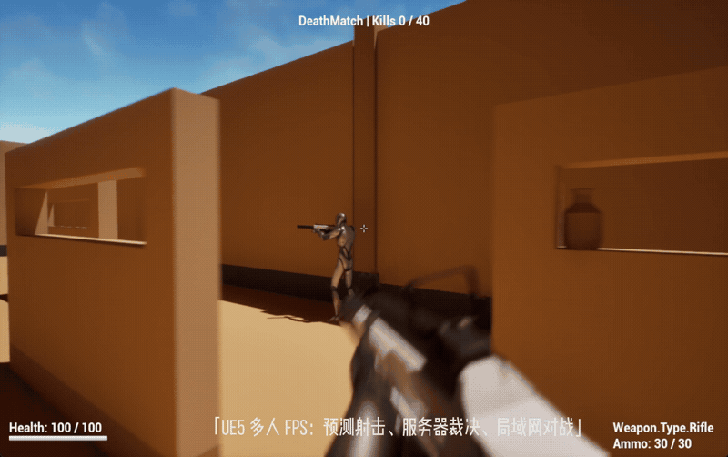
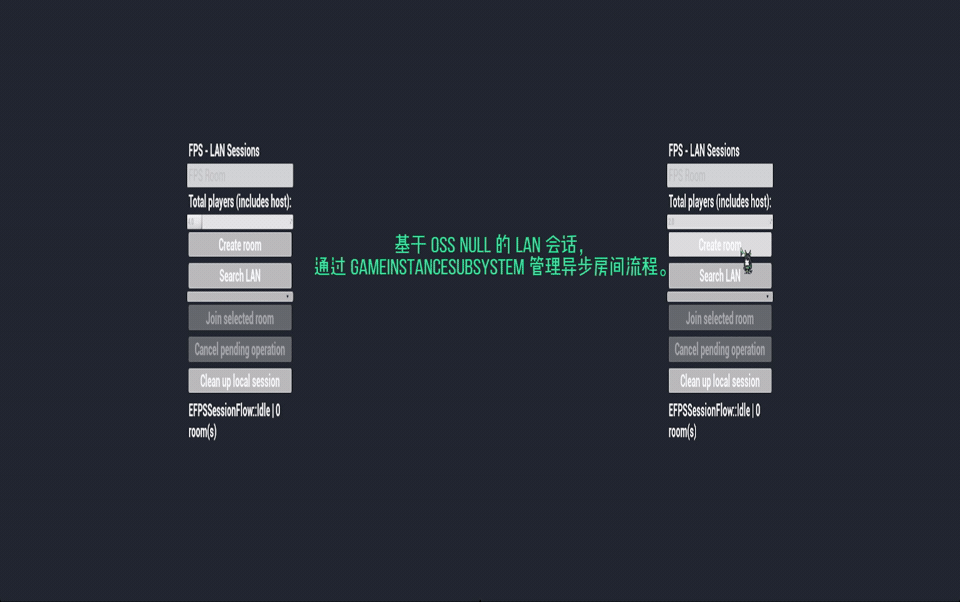
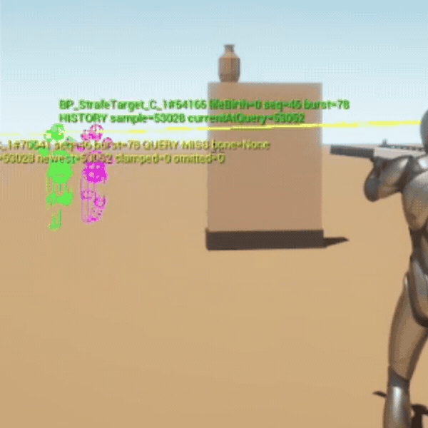
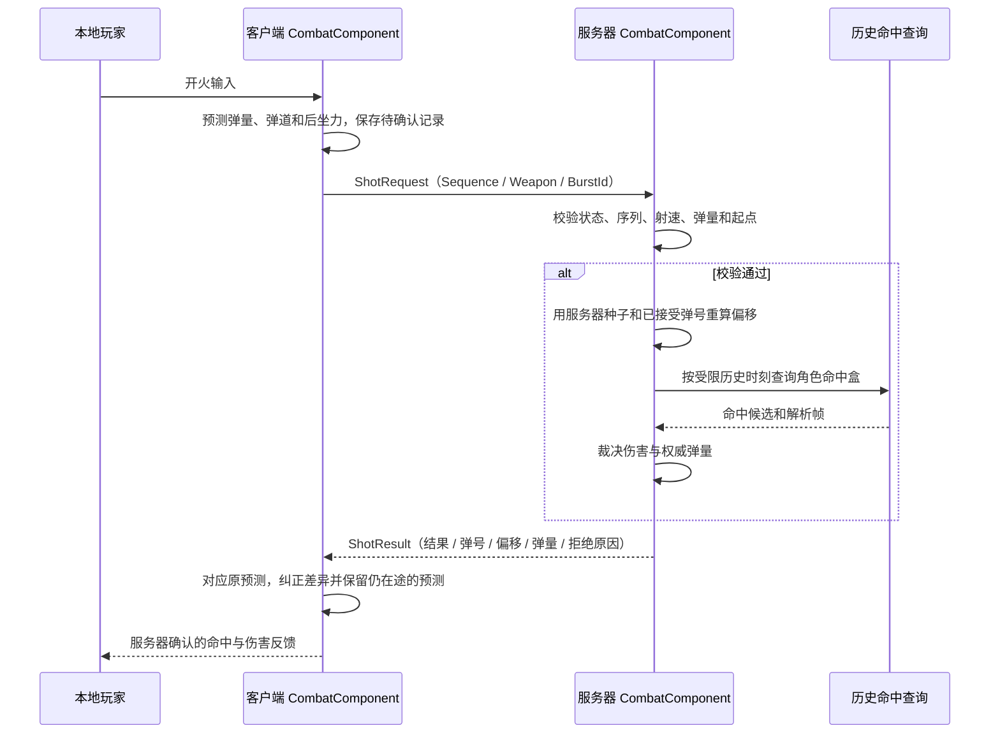

# FPS · UE5 多人对战原型

基于 **Unreal Engine 5.5.4 / C++ / Blueprint** 的多人 FPS 项目，围绕射击的**客户端预测、服务器权威校验、历史命中查询与结果校正**展开，包含局域网房间、大厅、DeathMatch 和客户端战斗反馈。

面向游戏客户端开发的学习与作品展示。角色移动使用 UE CharacterMovement；项目自行实现的预测主要针对射击、弹量和后坐力。

**[观看完整演示 · 3分14秒](https://github.com/How-to-express-something/FPS/releases/tag/v0.1.0-demo)** · **[下载 MP4](https://github.com/How-to-express-something/FPS/releases/download/v0.1.0-demo/fps-demo-2026-11.mp4)** · [验证摘要](Verification/results.json)



> **仓库范围**：这是筛选后的源码展示版，包含 C++、配置、自建蓝图、演示 GIF 和验证摘要。第三方角色、武器动画及场景原始资产不随仓库分发，首次克隆需要补齐依赖才能还原完整画面与联机流程，见[资源与运行要求](#资源与运行要求)。完整视频通过 Release 附件提供，不进入 Git 历史。

## 演示导览

| 时间（约） | 内容 | 观察重点 |
| --- | --- | --- |
| 00:00–00:36 | DeathMatch 战斗 | 瞄准、连发后坐力、换弹与命中反馈 |
| 00:36–01:20 | LAN 房间与大厅 | 创建、搜索、加入、Ready 和开始对局 |
| 01:20–01:50 | 正常网络下的射击预测与回执 | 本地弹量、Pending、Seq / Burst 和服务器确认 |
| 01:50–02:10 | 模拟延迟 | 本地即时表现与之后到达的 Ack；配置延迟和实测耗时分开显示 |
| 02:10–02:30 | 非法起点探针与弹量恢复 | `fps.Net.BadOriginOnce`；视频局部特写展示弹量 21→20→21 |
| 02:30–02:55 | 历史查询快照 | 黄色查询射线、绿色历史姿态、品红色处理该发时的当前姿态 |
| 02:55–03:14 | 恢复网络后再射击 | 对照恢复后的配置与确认耗时 |

### 房间流程



此 GIF 为原片 00:43 起约 35 秒的 **2.5 倍速**节选；用于浏览操作流程，不用于比较异步操作耗时。

### 历史姿态查询



绿色是该发实际采用的历史姿态，品红色是服务器处理该发时采样的当前姿态；两者均按值保存，后续角色移动不会重算旧快照。此 GIF 是原片约 02:43 起的局部裁剪。完整技术字段与双端视角请看视频，GIF 帧率不代表游戏运行帧率。

**读图边界**：几何 `QUERY HIT` 不等于实际扣血，还要看对应射手回执中的 Outcome / ActualDamage。录制后段房主自身面板保留了一次 `FrameInFuture` 拒绝；该发没有执行历史查询，与随后远端射手的快照不是同一请求。需要按 World、Pawn 生命期、Seq 和 Burst 对照，不能把房主自己的 Last ACK 当成所有远端玩家的回执。拒绝段的弹量特写裁掉了原因字段，逐发完整证据应结合原始日志，而非仅凭此特写。

## 核心实现

| 模块 | 实现与关注点 | 代码入口 |
| --- | --- | --- |
| 射击预测 / 权威 | 即时本地表现；服务器校验武器、弹量、射速、起点与请求序列；回执关联和拒绝恢复 | [FPSCombatComponent](Source/FPS/FPSCombatComponent.cpp) |
| 延迟补偿 | 历史球体 / 胶囊命中体缓存、射击时刻估计、历史姿态射线查询、历史窗口及角色生命期边界 | [FPSLagCompensationSubsystem](Source/FPS/FPSLagCompensationSubsystem.cpp) |
| 武器 | RPM、确定性后坐力、种子散射、首发无散射与渐进散射、换弹中断 | [FPSRecoil](Source/FPS/FPSRecoil.cpp)、[FPSWeaponDataAsset](Source/FPS/FPSWeaponDataAsset.h) |
| 房间 / 大厅 | OSS Null LAN 创建、搜索、加入、销毁；异步操作身份、超时和清理；Ready 与切图 | [Online](Source/FPS/Online)、[Lobby](Source/FPS/Lobby) |
| DeathMatch | 40 击杀获胜、计分、随机重生点、死亡镜头、3 秒复活保护及移动取消保护 | [FPSGameMode](Source/FPS/FPSGameMode.cpp)、[FPSCharacter](Source/FPS/FPSCharacter.cpp) |
| 客户端表现 | 1P / 3P 蒙太奇、镜头后坐力和 Camera Shake、固定准星、命中 / 爆头 / 击杀反馈、血量 / 弹药 UI | [UI](Source/FPS/UI)、[FPSHitReactionComponent](Source/FPS/FPSHitReactionComponent.cpp) |
| 网络可视化 | 真实逐发预测 / 回执缓存、10Hz 本地诊断面板、有界服务器查询快照、测试房主第一人称隐藏 | [NetworkDiagnosticsWidget](Source/FPS/UI/NetworkDiagnosticsWidget.cpp)、[FPSRecordingTestGameMode](Source/FPS/FPSRecordingTestGameMode.cpp) |
| 验证 | 原生自动化、多客户端 PIE、独立进程 LAN、网络模拟与逐发日志关联 | [Tests](Source/FPS/Tests)、[验证摘要](Verification/results.json) |

## 一发子弹如何完成预测与确认



关键取舍：

- **预测与伤害权限分离**：服务器使用自身状态和种子计算弹道，不直接相信客户端声称的命中或弹号。种子用于重现结果，不作为秘密凭据。
- **回执属于具体上下文**：Sequence 关联单发，Weapon 和 BurstId 区分武器与连发；切枪或旧预测已清理后，旧回执不能覆盖当前状态。
- **弹量校正保留在途请求**：显示值以权威基线减去仍待确认的本地射击，避免较早回执造成 UI 回跳或重复扣弹。
- **历史查询不搬动实际世界**：对保存的历史命中盒进行解析查询，不将整个物理世界回滚。
- **存活检查与业务身份共同约束回调**：换弹、会话等流程结合操作代次、取消和清理，处理切枪、死亡、退出与切图后的过期结果。

## 验证记录

以下是原工程的已有验证，**不是本次发布时重新运行的联合验收**。结构化摘要见 [Verification/results.json](Verification/results.json)，对应测试实现随源码提供。

| 日期 | 条件与结果 | 验证范围 |
| --- | --- | --- |
| 2026-11-10 | 人工 PIE 联机：151 次预测、150 次接受、1 次拒绝、151 个回执；逐条关联无缺失、重复或孤立回执 | 预测、服务器判定、确认与拒绝恢复链路 |
| 2026-11-10 | 模拟延迟阶段应用层确认耗时中位数约 246.94 ms，基线约 16.17 ms；BadOrigin 探针使显示弹量从 29 恢复至 30 | 服务器可拒绝预测，客户端执行纠正；该耗时不是底层 Ping |
| 2026-11-17 | 多客户端 PIE：2 项通过，0 失败 | 指定切图与表现回归路径；同进程多 World 不等于独立进程覆盖 |
| 2026-11-20 | FPSEditor Development 构建成功；44 项原生自动化通过，0 失败 / 未运行 | 该次构建的原生回归；NullRHI 不验证最终画面 |
| 2026-11-24 | 2 项三玩家 PIE 测试通过 | 在真实 Client RPC 链路校验查询标志、历史帧元数据与权威弹药回执；单进程多 World |
| 2026-11-25 | FPSEditor Development 构建成功；48 项原生自动化通过，0 失败 / 未运行 | 诊断回执身份、快照不可变性与容量、Widget 换 Pawn、测试房主显隐；NullRHI / nosound |

人工射击记录未覆盖恢复网络后的再次射击，不能单独证明全部历史命中边界公平。部分动画与 PIE 测试依赖完整资源；缺少依赖时，不能预期原工程全部测试开箱通过。

### 复现预测与权威验证

补齐资源并构建后，使用 **Listen Server + 至少一个远端客户端**。在客户端开火进行观察；仅操作监听主机不足以验证远端预测。

```text
fps.Net.Trace 1
fps.Net.Phase 1
fps.Net.Panel 1
```

先正常射击，再通过编辑器网络模拟设置增加延迟，标记新的 Phase 后继续射击。Development 环境可在远端客户端控制台执行：

```text
fps.Net.Phase 3
fps.Net.BadOriginOnce
```

该探针使下一发上报起点失效，但保留本地预测。检查 `[FPSNet]` 日志中的 `Predict → ServerAccept / ServerReject → Ack`，按玩家、Sequence 和 BurstId 关联，核对拒绝原因、弹量恢复、`offsetsMatch` 与待确认数量。结束后关闭网络模拟并再次射击，另记恢复样本。

显示客户端预测射线：`fps.Net.DrawPredicted 1`。在服务器观察窗口输入 `fps.Net.DrawShots 1` 显示最近一发真实查询，`2` 显示最近最多 8 发，`fps.Net.ShotSeconds 2` 设置保存时长。完整历史骨骼不复制到客户端；面板的服务器弹药值标记为最近一份回执快照，Ack 耗时是应用层往返确认时间。

补齐 Test 关卡依赖后，也可使用 `Tools/Start-DemoCapture.ps1 -Mode Test -Role Host -RunName take01 -Diagnostics -EngineRoot $EngineRoot` 启动房主，加载完成后以相同 RunName / Port、`-Role Client` 启动远端客户端。启动脚本关闭后台空闲，两个窗口采用相同的 60 FPS 上限。`BP_TestGameMode` 的专用父类只隐藏监听房主本地手臂 / 武器和其调试命中体，不改变权威碰撞与伤害。

原生自动化可在编辑器 Session Frontend / Automation 中按 `FPS` 筛选，或运行：

```powershell
& "$EngineRoot\Engine\Binaries\Win64\UnrealEditor-Cmd.exe" `
  "$PWD\FPS.uproject" -unattended -NullRHI -nosound `
  '-ExecCmds=Automation RunTests FPS' `
  '-TestExit=Automation Test Queue Empty' -ReportExportPath="$PWD\Saved\Automation"
```

完整资源环境下的双进程 LAN 会话回归入口：`Tools/Test-Sessions.ps1 -EngineRoot $EngineRoot`。它只管理本次脚本启动的测试进程，不结束用户编辑器。

## 资源与运行要求

**环境**：Windows、UE **5.5.4**、Visual Studio 2022 C++ 工具链、Windows SDK。使用 Enhanced Input、Gameplay Tags、UMG 和 OnlineSubsystem Null。

保留 `Content/FPS/` 下的项目蓝图、输入、数据资产、测试资产、菜单 / 大厅 / 过渡地图，以及项目生成的命中音效。这些资产仍引用原工程的骨骼、动画、武器与场景资源。

公开快照不含 `Content/AssaultRifle`、`Characters`、`Effects`、`FirstPersonArms`、`FPWeapon`、`Weapons`、`MilitaryWeapDark`、`MilitaryWeapSilver`、`LP_FPSLite_JC` 等资源包，也不包含 UE 模板内容目录。恢复时须从各自合法来源准备，并保持资产引用路径；各资源的许可不因发布本项目而改变。

当前对局地图为 `/Game/LP_FPSLite_JC/Maps/Demo`。补齐场景后使用原配置；或自行配置包含 GameMode、PlayerStart 和角色 / 武器的地图，修改 `Config/DefaultGame.ini` 的 `MatchMap`、`MapsToCook` 及其他软引用。仅替换地图名不能自动补齐其余资源。

### 构建

```powershell
git clone https://github.com/How-to-express-something/FPS.git
cd FPS
$EngineRoot = 'C:\Path\To\UE_5.5.4'

# 普通 UBT 编译前保存资源并关闭该项目编辑器
powershell -NoProfile -ExecutionPolicy Bypass -File .\Tools\Build-Editor.ps1 -EngineRoot $EngineRoot

# 源码引擎环境下重新生成项目文件
powershell -NoProfile -ExecutionPolicy Bypass -File .\Tools\Generate-ProjectFiles.ps1 -EngineRoot $EngineRoot
```

补齐资源后打开 `FPS.uproject`；通过主菜单创建或搜索局域网房间，进入大厅后就绪并开始比赛。网络范围为 **OSS Null / LAN**，公网会话、Steam / EOS 和部署后的 Dedicated Server 不属于当前交付。

## 目录

```text
Source/FPS/
  FPSCombatComponent.*          射击、换弹、预测和确认
  FPSRecoil.*                   后坐力轨道与渐进散射
  FPSLagCompensationSubsystem.* 历史命中查询
  FPSGameMode.* / FPSGameState.* 对局与复制状态
  Online/                       Session 异步生命周期
  Lobby/                        大厅、就绪与切图
  UI/                           HUD、反馈、确认伤害与网络诊断
  Tests/                        原生和 PIE 回归
Content/FPS/                    自建蓝图、输入与地图
Config/                         项目和联机配置
Tools/                          构建、资源生成与验证入口
SourceAssets/Audio/             代码生成的命中提示音
Verification/results.json       历史验证摘要
docs/media/                     成片节选 GIF
```

## 当前边界与后续工作

- 已具备房间、大厅、对局、重生和返回大厅链路；演示视频与 GIF 已发布，独立可分发试玩包尚未发布。
- 需要继续验证独立进程、动态遮挡、极端延迟、丢包与重生边界下的回溯公平性；权威检查不等于完整反作弊方案。
- 性能定位使用 Unreal Insights；角色首次初始化与后续重生的差异，不能直接当作一次优化的前后收益。
- 开发、测试梳理和文档整理使用 AI 辅助；保留实际验证结果、限制和可追踪代码入口。

后续围绕独立进程弱网、录制中出现的异常帧拒绝与可复现边界继续补齐验证。
